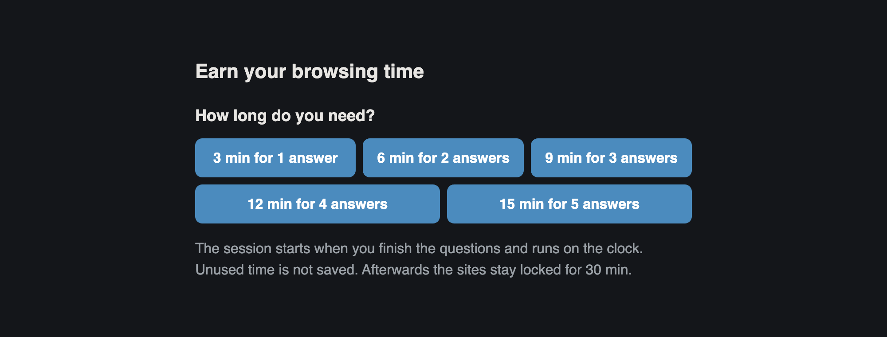
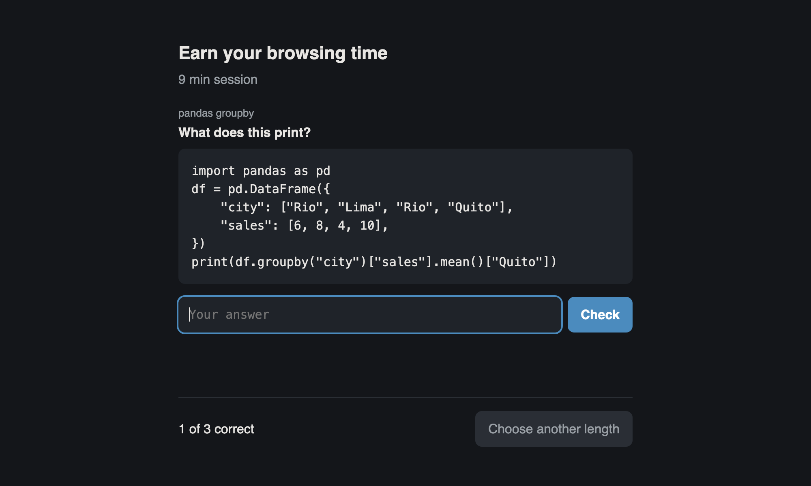
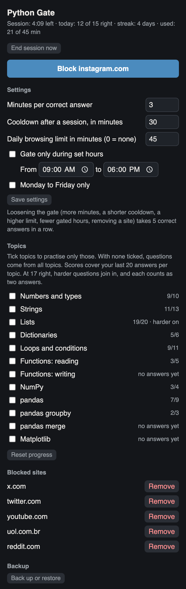

# Python Gate

A Chrome extension that makes you answer short Python questions before you can open distracting websites. Each visit buys one short session, paid for in correct answers.

The idea comes from a [post by @keysmashbandit](https://x.com/keysmashbandit/status/2109660673663729989), who did the same with mental maths and sudoku. The session rules follow [Intention](https://chromewebstore.google.com/detail/intention-stop-mindless-b/dladanhaondcgpahgiflodhckhoeohoe), which makes you commit to a time limit on each visit.





## How it works

- A blocked site opens behind a full-page screen that asks how long you need
- Each length has a price in correct answers. By default 1 answer buys 3 minutes, up to 15 minutes for 5 answers
- After a wrong answer you get one more try, which does not count. Then the quiz shows the answer with a one-line explanation
- The session starts when you finish the questions and runs on the clock, with a countdown in the bottom-right corner
- Leaving the site does not pause the session, and unused time is not saved
- When the session ends, every blocked site locks for a 30-minute cooldown. No quiz is offered during it
- All blocked sites share the same session and cooldown
- On a blocked site, the toolbar icon shows the minutes left: blue for the session, grey for the cooldown

## Install

Python Gate is not on the Chrome Web Store, so you load it from this folder.

1. Download or clone this repository
2. Open `chrome://extensions` and turn on "Developer mode" (top right)
3. Click "Load unpacked" and choose the `python-gate` folder
4. Pin the extension to the toolbar (puzzle icon, then the pin)

After you edit any file, press the reload arrow on the extension's card in `chrome://extensions`.

## Block and unblock sites

The default list is x.com, twitter.com, youtube.com, uol.com.br and reddit.com.

- To block a site, open it, click the Python Gate icon and press the "Block" button
- To unblock a site, click the icon and press "Remove" next to its name

Blocking a site also blocks its subdomains, so `youtube.com` covers `m.youtube.com`.

## Settings

Click the Python Gate icon to open the popup. Change the settings there, then press "Save settings".



| Setting | Default | What it does |
|---------|---------|--------------|
| Minutes per correct answer | 3 | Session time bought by each correct answer, from 1 to 60 |
| Cooldown after a session | 30 | Minutes the sites stay locked after a session. 0 means no cooldown |
| Daily browsing limit | none | Most session minutes you can start per day |
| Gate only during set hours | off | Hours when the gate is on. When off, the gate is always on |
| Monday to Friday only | off | Leaves weekends open. It applies when set hours are on |

The set hours can run past midnight, such as 22:00 to 06:00. Outside them, blocked sites open normally.

Changes that tighten the gate save at once. Changes that loosen it take 5 correct answers in a row:

- more minutes per answer
- a shorter cooldown
- a higher daily limit, or none
- fewer gated hours
- removing a site

While a session runs, the popup shows the time left and an "End session now" button. Ending early starts the cooldown at once and returns the unused minutes to the daily limit.

## Questions

There are 142 question types in 12 topics. Each type uses random values, so questions rarely repeat exactly.

| Topic | Types | Harder | Examples |
|-------|-------|--------|----------|
| Numbers and types | 6 | 2 | `//`, `%`, `**`, `int()`, `float()` |
| Strings | 14 | 3 | indexing, slicing, methods, `:.2f`, `:,`, `round` |
| Lists | 14 | 3 | slicing, comprehensions, `pop`, `append` versus `extend`, `sort` |
| Dictionaries | 8 | 2 | `.get`, `.items`, counting, nested dictionaries |
| Loops and conditions | 14 | 3 | `range`, `while`, `enumerate`, `zip`, `break`, `continue` |
| Functions: reading | 11 | 3 | scope, missing `return`, keyword arguments, lambdas |
| Functions: writing | 9 | 3 | fill in the blank: `return`, `def`, parameters, defaults |
| NumPy | 9 | 2 | indexing, `axis`, boolean masks, `reshape` |
| pandas | 12 | 3 | filtering, `sort_values`, missing values, `.str` |
| pandas groupby | 5 | 2 | `mean`, `ngroups`, `idxmax`, `agg`, `transform` |
| pandas merge | 4 | 2 | inner, left, right and outer merges, suffixes |
| Matplotlib | 6 | 2 | plot types, labels, `subplots`, `df.plot` |

A question takes one of three forms:

- What does this snippet print?
- What goes in the blank? The code has one `____` and you type the missing piece
- Which line has the bug? The lines are numbered and you type the number

Answers ignore spacing and quote style. Capital letters count (`True`, not `true`), and so does `3.0` versus `3`.

## Topics and progress

In the popup you choose what to practise and see how you are doing.

- With no topic ticked, questions come from all topics. This is the default
- Tick one or more topics to practise only those
- The quiz shows the topic above each question
- The score next to a topic covers your last 20 answers in it, such as `17/20`
- At 17 right out of 20, the topic's harder questions join in. Each one counts as two answers, and they stay unlocked
- A wrong answer makes that question type come up twice as often, up to 8 times the normal rate
- A right answer halves the rate, down to a quarter of normal
- The top line shows the session or cooldown time left, today's answers and how many days in a row you have practised
- "Reset progress" clears the scores, the rates, the unlocked harder questions and the daily counts

## Backup

Chrome deletes an extension's data when you remove the extension. To keep your progress, press "Back up or restore" in the popup. A page opens with two options.

- "Download backup" saves your blocked sites, settings, ticked topics and progress as a file
- Choosing a backup file restores it

A backup holds no session and no record of today's usage, so restoring one never gives time back. A restore also cannot loosen the gate:

- progress and ticked topics are replaced
- sites in the file are added to your block list, and none are removed
- settings are restored only if they are as strict as your current ones

## Permissions

Chrome will say the extension can read and change data on all websites. The extension needs this so you can block any site from the toolbar. On sites outside your block list it checks the address and does nothing else.

Python Gate makes no network requests. Your block list, settings and progress stay in Chrome's local storage.

Chrome switches extensions off in Incognito windows unless you allow them, so the gate does not apply there by default.

## Tests

| Script | What it checks | Needs |
|--------|----------------|-------|
| `tests/check_answers.py` | Runs 300 versions of every question in real Python and compares the output with the extension's answer. Also checks topic selection, progress rules and the schedule | Node, pandas, NumPy, Matplotlib |
| `tests/smoke_test.js` | Runs the quiz and the popup against a simulated page: choosing a session, retry, countdown, cooldown, daily limit, schedule, the toolbar badge, the 5-in-a-row rule and backups | Node |

```bash
python3 tests/check_answers.py
```

```bash
node tests/smoke_test.js
```

To add questions, edit the `BANK` list in `questions.js` and run both scripts again.

## Files

| File | Contents |
|------|----------|
| `manifest.json` | Extension settings |
| `sites.js` | Stored settings, default block list, schedule, streak and backup rules |
| `questions.js` | Question generators, answer checking and progress rules |
| `content.js` | Session chooser, quiz, countdown and cooldown |
| `popup.html`, `popup.js` | Toolbar popup: block list, settings, topics and progress |
| `background.js` | Minutes shown on the toolbar icon |
| `backup.html`, `backup.js` | Backup and restore page |
| `tests/` | The two test scripts |
| `screenshots/` | Images used in this README, made with sample data |

## Licence

Python Gate is released under the [MIT Licence](LICENSE).
